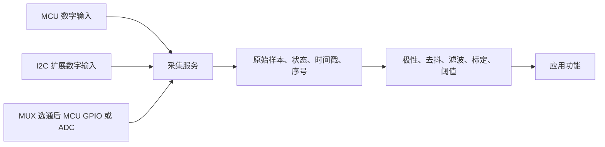

# IO 端点与采集路线设计

> [!abstract] 依据与范围
> SWS_IOHardwareAbstraction §7.9.1 的官方例子已经讨论多路复用数字输入、周期采样、去抖，以及功率芯片快速过流关断。下面的端点表、路线表与状态机是结合本项目提出的设计，不是 AUTOSAR 强制的数据结构；RS2260/PCA9555/TCA9539 的具体参数尚需芯片手册和原理图。

## 一、拆开三个独立维度

| 维度 | 含义 | 示例 |
|---|---|---|
| 端点 Endpoint | 最终可访问的硬件资源与能力 | MCU Dio、MCU ADC、扩展器数字口 |
| 路线 Route | 到达采样端之前的连接与选通 | 直连、MUX0 CH3、MUX1 CH5 |
| 信号 Signal | 值的含义、有效性和时间规则 | 低有效按钮、标定电压、带迟滞状态 |

高／低有效不是模拟开关驱动的业务属性；ADC 电压通过阈值判定为数字状态，也不意味着硬件采样方式变成 Dio。



## 二、静态配置足以支持首版

| 逻辑信号 | 路线 | 采样端 | 解释 |
|---|---|---|---|
| DoorButton | DIRECT | MCU_DIO_A3 | 低有效、去抖 |
| LightButton | MUX0:CH2 | MCU_DIO_B2 | 高有效、去抖 |
| SensorVoltage | MUX1:CH4 | MCU_ADC_CH5 | 标定、滤波 |
| ServiceButton | DIRECT | EXP0:P03 | 低有效、去抖 |

这些是示例标识，不是已确认板卡接线。同一 COM 若共享 GPIO/ADC 或存在 MCU 引脚模式切换，要建立同一资源组，不能把它们视为独立同时采样端。

配置包括设备实例、端点能力、MUX 地址脚端点与有效极性、可选使能端、输入通道、采样方式、建立时间、最大年龄、周期与解释规则。先支持真实需要的几种路线，不必实现任意连接图。

## 三、器件驱动只承担器件合同

RS2260：选择通道与使能的控制、完成状态。PCA9555/TCA9539：方向配置、输入读取、输出影子、通信完成／失败、复位后重配置。

统一数字端点 ID 不意味着相同访问延迟。I²C 扩展端点不应被业务误认为可在 ISR 中瞬时访问的 MCU GPIO。

若使用扩展器的极性反转寄存器，逻辑信号层必须知道该配置；一般建议只在一个确定层解释逻辑极性，避免双重反转。

## 四、扫描状态机

```text
IDLE → 申请路线资源 → 提交选通 → 等选通完成
     → 等建立时间 → 启动采样 → 等采样完成
     → 发布样本 → 释放／复用资源 → 下一通道
任意错误 → 标记失败／过期 → 恢复设备或跳过 → 按策略重试
```

若地址脚由 I²C 扩展器控制，建立计时从**实际写入完成**后开始，不从请求提交时开始。

选择位不一定能同时变化；需要评估中间通道、使能脚或分组写入策略。进入目标通道并稳定后才允许采样。具体措施取决于芯片和电路，不能默认存在 break-before-make 或任意控制脚。

ADC 的建立时间还包含前端 RC、信号源阻抗、开关导通电阻、采样电容和采样窗口；是否丢弃首转换依目标手册和验证决定。通道索引必须跟随异步 ADC 作业，而非在完成时读取可能已改变的“当前通道”。

## 五、共享资源和失败传播

同一 MUX／COM／ADC 组由一个管理者占用到所需采样完成。诊断请求刷新也进入同一路线调度，不能直接改地址脚。

一个扩展器的输出影子由单一驱动管理并串行提交，避免两个请求各改一位而相互覆盖。多个选择脚存在跨端口写入时，完成与稳定策略必须覆盖所有相关写作业。

器件失败可能同时影响多条信号，故障层应区分根因与受影响信号，避免每个按钮都误报成传感器开路。

## 六、样本合同

```c
/* 项目建议类型，非 AUTOSAR 标准类型 */
typedef struct {
    uint32_t raw;
    uint32_t sampled_at;
    uint32_t sequence;
    InputQuality quality; /* INIT / VALID / STALE / ERROR，项目定义 */
} InputSample;
```

接口明确 timestamp 的时基、回绕处理、sequence 的更新条件和质量优先规则。样本值、状态和时间戳应作为一致快照发布。

读缓存不产生新采样。去抖只在采样序号变化时推进，或按连续有效状态的真实时间推进；重复读取旧缓存不能增加稳定计数。失败后的旧值只能附带过期／错误状态，禁止默认为有效。

## 七、诊断和输出

读 DID 优先读取快照；需要新样本时提交带时限的刷新请求。HSD 请求经过控制权仲裁和保护，不能直接将“诊断写值”当作实际反馈。静态 RAM 足以容纳采样表和上下文，不需每次写 NVM。

## 八、配置与时序验收

检查通道越界、输入输出能力、选择脚冲突、路线循环依赖、非法共享、信号极性和初始化值。总扫描预算包含总线等待、选通、建立、转换、调理和调度抖动。

快速保护需求不能由慢速 MUX 扫描硬凑。官方例子的具体时间只属于其假设，不可直接复制为本项目预算。应分别测试通道串扰、首次转换、总线失败、复位、诊断抢占和最坏新鲜度。

## 核对依据

- [SWS_IOHardwareAbstraction，PDF 第 34 页](file:///H:/Bcm_Frame/doc/AUTOSAR-CP_R25-11%E5%AE%98%E6%96%B9%E8%B5%84%E6%96%99/AUTOSAR_CP_SWS_IOHardwareAbstraction.pdf#page=34)：§7.9.1 示例的输入、MUX 与功率保护需求
- [SWS_IOHardwareAbstraction，PDF 第 35 页](file:///H:/Bcm_Frame/doc/AUTOSAR-CP_R25-11%E5%AE%98%E6%96%B9%E8%B5%84%E6%96%99/AUTOSAR_CP_SWS_IOHardwareAbstraction.pdf#page=35)：Table 7.1，采样与保护分工
- [SWS_IOHardwareAbstraction，PDF 第 48 页](file:///H:/Bcm_Frame/doc/AUTOSAR-CP_R25-11%E5%AE%98%E6%96%B9%E8%B5%84%E6%96%99/AUTOSAR_CP_SWS_IOHardwareAbstraction.pdf#page=48)：功能诊断控制
- [SWS_IOHardwareAbstraction，PDF 第 49 页](file:///H:/Bcm_Frame/doc/AUTOSAR-CP_R25-11%E5%AE%98%E6%96%B9%E8%B5%84%E6%96%99/AUTOSAR_CP_SWS_IOHardwareAbstraction.pdf#page=49)：功能诊断读值

**返回** → [[AUTOSAR知识地图]]
