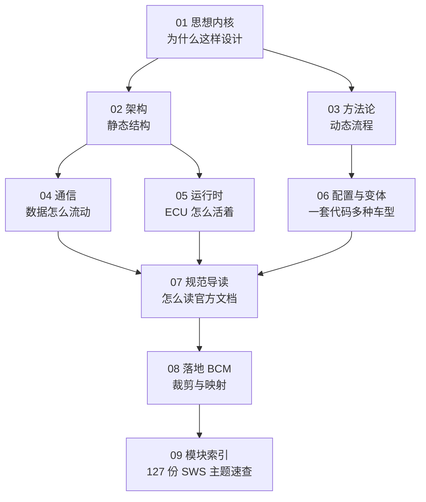

# AUTOSAR CP 学习体系

> [!important] 2026-10-23 审查入口
> 先读 [[R25-11审查报告]] 与 [[逐篇审查记录]]，区分官方结论、教学简化和项目建议。与当前项目直接相关的扩展为 [[06-IO端点与采集路线设计]]、[[07-业务绑定诊断与任务落地]]。原文件名保留，官方 PDF 使用外部本地链接。


> [!abstract] 这套文档是什么
> 不是 SWS 规范的中文翻译，而是**以本地 R25-11 官方资料建立的认知框架**；本轮审查范围与限制见 [[R25-11审查报告]]。
> 目标只有一个：让你在拿到任何一份 AUTOSAR 规范时，知道它在体系中的位置、为什么这样设计、以及能落到你的 BCM 项目哪里。

## 一句话结论

> **本文以一个主要学习视角组织 AUTOSAR：让"汽车功能"这份软件资产，与它运行在哪颗 MCU、挂在哪个网络、由哪家供应商实现，尽量解耦，并满足接口、资源与时序约束。**

这句话推出后面所有东西：

| 推论 | 在标准里的体现 | 对应文档 |
|---|---|---|
| 功能必须能脱离部署描述 | 虚拟功能总线 VFB | [[03-虚拟功能总线VFB]] |
| 上层不能感知硬件 | MCAL 标准化接口 | [[02-MCAL微控制器抽象层]] |
| 组件不能感知通信机制 | 三种接口类型 + RTE 生成 | [[08-三种接口类型]] |
| 同一份代码要适配多车型 | 配置三态 + VARIANT | [[01-配置三态]] |
| 主机厂与供应商要能分工 | 两阶段开发 + Extract 交付 | [[06-两阶段开发与OEM供应商分工]] |
| 不同供应商的模块要能拼装 | BSW 通用需求 + 命名规范 | [[02-如何读一份SWS]] |

## 三条学习路径

不同目的走不同路线，不必按目录顺序读。

### 路径 A：建立认知（第一次系统学，建议 2-3 天）

```
AUTOSAR要解决什么问题 → 第一性原理 → VFB → 分层哲学
→ 分层架构总览 → BSW模块类型分类法 → 三种接口类型
→ 方法论总览 → 两阶段开发
```

终点：能画出 AUTOSAR 的整体骨架，并能解释每一层为什么存在。

### 路径 B：上手写代码（驱动/BSW 开发，建议 1 周）

```
分层架构总览 → MCAL → ECU抽象层 → BSW模块类型分类法
→ 横向纵向接口规则 → 如何读一份SWS → 错误处理三级分类
→ 配置三态 → 通信栈全景 → CanIf与CanDrv → CanTp
```

终点：能读懂一份 SWS，能按 AUTOSAR 规范写一个 BSW 模块。

### 路径 C：项目落地（把 BCM 套进 AUTOSAR，建议配合项目推进）

```
BCM在AUTOSAR中的定位 → 车身域标准SWC分解 → Mini-AUTOSAR分层映射
→ 裁剪决策记录 → 常见落地误区
```

终点：明确"我的项目该实现哪几层、不实现哪几层、边界在哪"。

## 全库地图



## 核心文档速查（按重要度排序）

| 官方文档 | 中文名 | 为什么重要 | 导读 |
|---|---|---|---|
| EXP_LayeredSoftwareArchitecture | 分层软件架构 | 静态结构权威定义，182 页幻灯片全是干货 | [[01-分层架构总览]] |
| TR_VFB | 虚拟功能总线 | **思想源头**，讲清为什么要有 RTE | [[03-虚拟功能总线VFB]] |
| TR_Methodology | 方法论 | 从功能到 ECU 代码的完整产物链 | [[01-方法论总览-V模型产物链]] |
| RS_BSWGeneral | BSW 通用需求 | BSW 的"宪法"，所有 SWS 都要引用它 | [[02-如何读一份SWS]] |
| TPS_SoftwareComponentTemplate | 软件组件模板 | SWC 九种类型的权威定义 | [[10-软件组件SWC九种类型]] |
| EXP_ModeManagementGuide | 模式管理指南 | BCM 睡眠唤醒的理论依据 | [[02-模式管理EcuM与BswM]] |
| EXP_NVDataHandling | NVM 数据指南 | NvM 四种基本存储对象、三种块管理类型 | [[06-NVM数据管理]] |
| EXP_AIBodyAndComfort | 车身舒适域应用接口 | **BCM 的标准 SWC 分解** | [[02-车身域标准SWC分解]] |
| TR_ReleaseOverview | 版本概览 | CP/AP/FO 格局、版本生命周期 | [[04-规范项生命周期与版本]] |

## 阅读约定

本库所有文档遵循三条规则：

1. **结论前置**：每篇开头第一段就是结论，不铺垫。
2. **原文可追**：引用规范条目一律带编号（如 `[SRS_BSW_00161]`、`[TR_METH_01047]`），可在 `doc/AUTOSAR-CP_R25-11官方资料/` 下原文核对。
3. **落到项目**：涉及架构决策的地方，都给出与 BCM/CVM014x 项目的对照。

## 标签体系

| 标签 | 含义 |
|---|---|
| `#MOC` | 内容地图（导航页） |
| `#思想` | 原理与设计动机 |
| `#架构` | 静态结构 |
| `#方法论` | 流程与产物 |
| `#机制` | 运行时行为 |
| `#规范导读` | 如何读规范 |
| `#落地` | 与项目结合 |
| `#待验证` | 有疑问、需在项目中确认的点 |

## 资料源

- 官方资料：`H:\Bcm_Frame\doc\AUTOSAR-CP_R25-11官方资料\`（本地 212 份 PDF；模型与示例另见资料索引）
- 本库基于版本：**AUTOSAR CP R25-11**（2025-11-27 发布）

> [!warning] 版本敏感性
> AUTOSAR 每年 11 月发布一次，条目会新增/废弃。引用具体条目号时务必核对版本，跨版本差异见 [[04-规范项生命周期与版本]]。

## 工具页

| 页面 | 用途 |
|---|---|
| [[术语表]] | 缩写速查（读到不认识的词就查这里） |
| [[原始资料索引]] | 212 份官方文档清单 + 优先级标注 |
| [[01-模块索引总表]] | 127 份 SWS 主题（字母序） |
| [[02-按层归类的127个模块]] | 127 份 SWS 主题（按层 + BCM 适用性） |
| [[概念卡模板]] | 记录新概念 |
| [[规范导读卡模板]] | 读完 SWS 后产出速查卡 |
| [[决策记录模板]] | 记录架构/裁剪决策 |

## 库的规模

| 目录 | 篇数 | 内容 |
|---|---|---|
| 00-导航 | 7 | 知识地图、学习路径、术语表、资料索引 |
| 01-思想内核 | 7 | 第一性原理、VFB、分层哲学 |
| 02-架构 | 12 | 各层详解、模块分类、接口规则 |
| 03-方法论 | 8 | 产物链、SPEM、Extract、ARXML |
| 04-通信 | 8 | 通信栈、PDU、Com、PduR、CanIf、TP、NM、DBC |
| 05-运行时 | 9 | 启动、模式、RTE、OS、错误、NVM、诊断、看门狗、存储栈 |
| 06-配置与变体 | 3 | 配置三态、VARIANT、产品线 |
| 07-规范导读 | 5 | 文档体系、读 SWS、追溯、版本、变更 |
| 08-落地BCM | 7 | 定位、SWC 分解、分层映射、裁剪、误区 |
| 09-模块索引 | 2 | 127 份 SWS 主题索引 |
| 10-模板 | 3 | 概念卡、导读卡、决策记录 |
| **合计** | **72** | （含本 README） |

---

## 从这里开始

| 你的目的 | 入口 |
|---|---|
| **建立认知**（2~3 天） | [[01-AUTOSAR要解决什么问题]] |
| **快速导航** | [[AUTOSAR知识地图]] |
| **按角色选路线** | [[学习路径]] |
| **直接落地到项目** | [[03-Mini-AUTOSAR分层映射]] |
